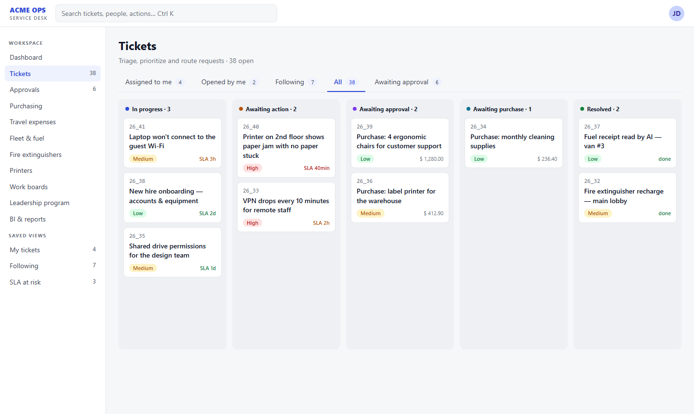
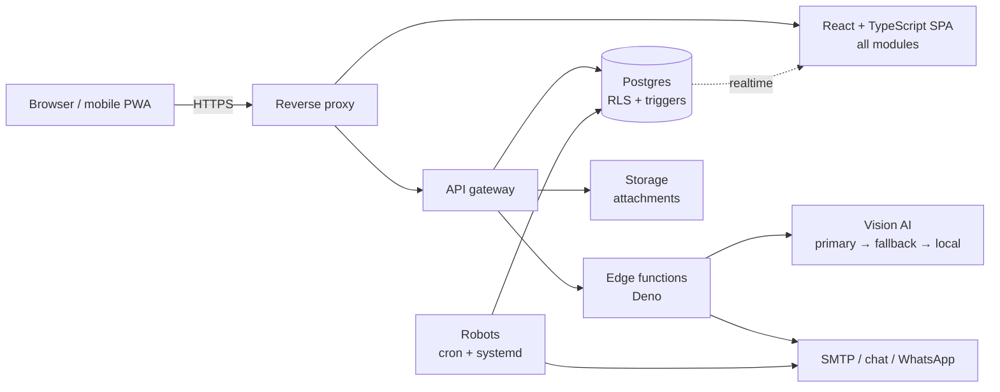

# Service Desk Platform — one portal, many internal systems

A self-hosted, multi-module operations portal I designed and built for the company I work at.
It started as an IT help desk and grew into the **hub that runs a dozen internal systems** on a
single login, a single database and a single permission model.

> This is a curated showcase. The production code lives in a private repository; everything here
> was written for this page. No credentials, IPs, company names, people or proprietary logic.



## What it does

| Module | What it solves |
| --- | --- |
| **Service desk** | Tickets with SLA on business hours, kanban/table/timeline views, watchers, co-owners, mentions, attachments with retention |
| **Purchasing & approvals** | Purchase orders, approval by one-time link (no login needed), WhatsApp/e-mail notifications, receipts |
| **Fleet & travel expenses** | Drivers and staff photograph receipts; an AI vision pipeline fills the form; managers approve and export |
| **Facilities** | Fire-extinguisher inventory with month-based expiry and alerts, printers and consumables |
| **People programs** | A leadership program app with phases, private journals and an achievement emblem |
| **BI & reports** | Financial/purchasing/supply dashboards, Excel exports, embedded analytics |
| **Work boards** | A Trello-style board for internal projects, linked to tickets |

## Engineering highlights

- **One database, many apps.** Every module is a route in the same React SPA and a set of tables in the
  same Postgres, guarded by **Row Level Security** and per-user capability flags — adding a module is
  a migration plus a page, not a new deployment.
- **Self-hosted Supabase.** Postgres, Auth, Storage, Realtime and Deno edge functions run on the
  company's own server (Docker Compose), behind a reverse proxy. ~400 versioned SQL migrations.
- **AI with a fallback chain.** Receipt OCR tries a primary vision model, falls back to a second provider,
  then to a local router — with hard timeouts so a dead provider never hangs the user. A watchdog
  self-heals retired models and only alerts after **two consecutive failures** (no false alarms).
- **Human-friendly numbering.** Tickets get a yearly protocol (`26_1`, `26_2`… → `27_1`) generated by a
  concurrency-safe trigger, while the internal id stays stable so links, approvals and robots never break.
- **Robots around the core.** Cron/systemd workers sync spreadsheets, send weekly reports, deliver
  WhatsApp approvals and watch disks and services — all writing to the same database the portal reads.
- **Ops hygiene.** Every deploy mirrors the code to a private repo; a pre-push guard refuses to commit
  env files, keys, browser profiles or data dumps.

## Architecture



## Code samples (written for this showcase)

**Yearly protocol, safe under concurrency** — one row per year, incremented atomically:

```sql
create table ticket_protocol_seq (year int primary key, last int not null default 0);

create function assign_protocol() returns trigger language plpgsql as $$
declare y int; n int;
begin
  if new.protocol is null then
    y := extract(year from (coalesce(new.opened_at, now()) at time zone 'America/Sao_Paulo'))::int;
    insert into ticket_protocol_seq as s (year, last) values (y, 1)
      on conflict (year) do update set last = s.last + 1
      returning last into n;
    new.protocol := lpad((y % 100)::text, 2, '0') || '_' || n;   -- 26_1, 26_2…
  end if;
  return new;
end $$;

create trigger tickets_protocol before insert on tickets
  for each row execute function assign_protocol();
```

**AI fallback chain with hard timeouts** (edge function, TypeScript):

```ts
type Engine = { name: string; read: (img: string, signal: AbortSignal) => Promise<Receipt> };

async function readReceipt(img: string, engines: Engine[]): Promise<Receipt & { engine: string }> {
  const errors: string[] = [];
  for (const e of engines) {
    const ctrl = new AbortController();
    const timer = setTimeout(() => ctrl.abort(), 25_000);   // never hang the user
    try {
      return { ...(await e.read(img, ctrl.signal)), engine: e.name };
    } catch (err) {
      errors.push(`${e.name}: ${(err as Error).message}`);   // try the next one
    } finally {
      clearTimeout(timer);
    }
  }
  throw new Error(`all engines failed — ${errors.join(' | ')}`);
}
```

**Money input that accepts what people actually type** (`36`, `36.00`, `36,00`, `1.234,56`, `1,234.56`):

```ts
export function parseMoney(input: string): number {
  let s = input.replace(/[^\d.,-]/g, '');
  const comma = s.lastIndexOf(','), dot = s.lastIndexOf('.');
  if (comma >= 0 && dot >= 0) {                     // both: the last one is the decimal mark
    const dec = comma > dot ? ',' : '.';
    s = s.split(dec === ',' ? '.' : ',').join('').replace(dec, '.');
  } else if (comma >= 0) {
    s = s.replace(',', '.');                         // "36,00"
  } else if (dot >= 0 && !/^\d+\.\d{1,2}$/.test(s)) {
    s = s.split('.').join('');                       // "1.234" = thousands
  }
  return Number(s);
}
```

## Stack

React · TypeScript · Vite · Supabase (Postgres, Auth, Storage, Realtime, Edge Functions/Deno) ·
Docker Compose · Python & Node workers · Playwright for end-to-end checks · LLM vision APIs

## Privacy note

Screenshots use fictitious data rendered from a mock. Company, people, hosts and business rules are
intentionally omitted.
